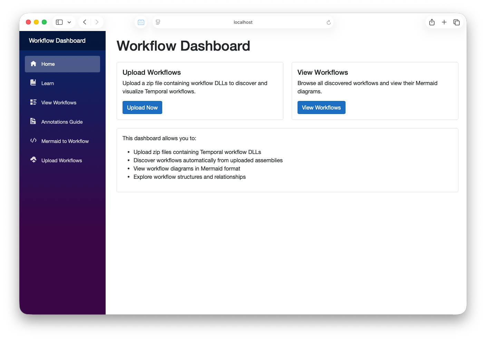
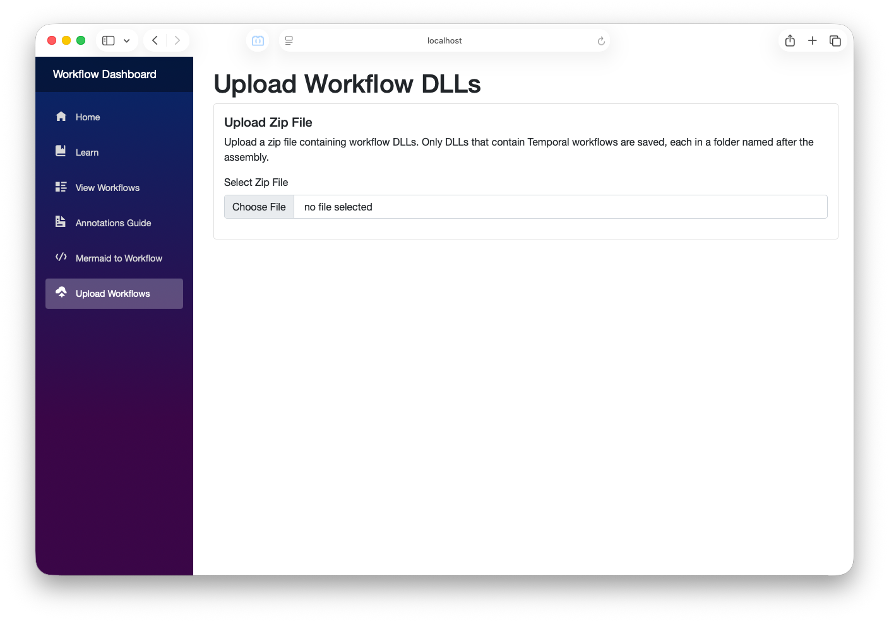
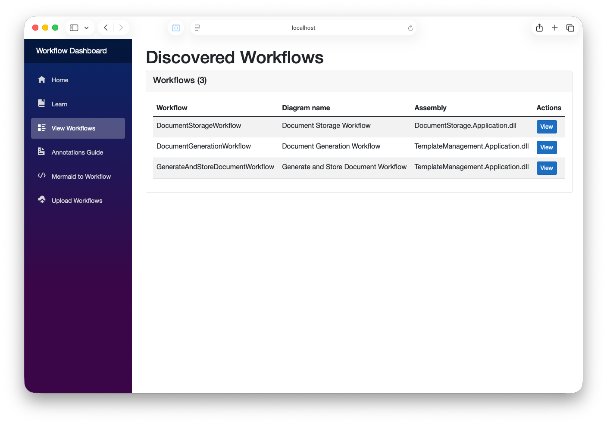
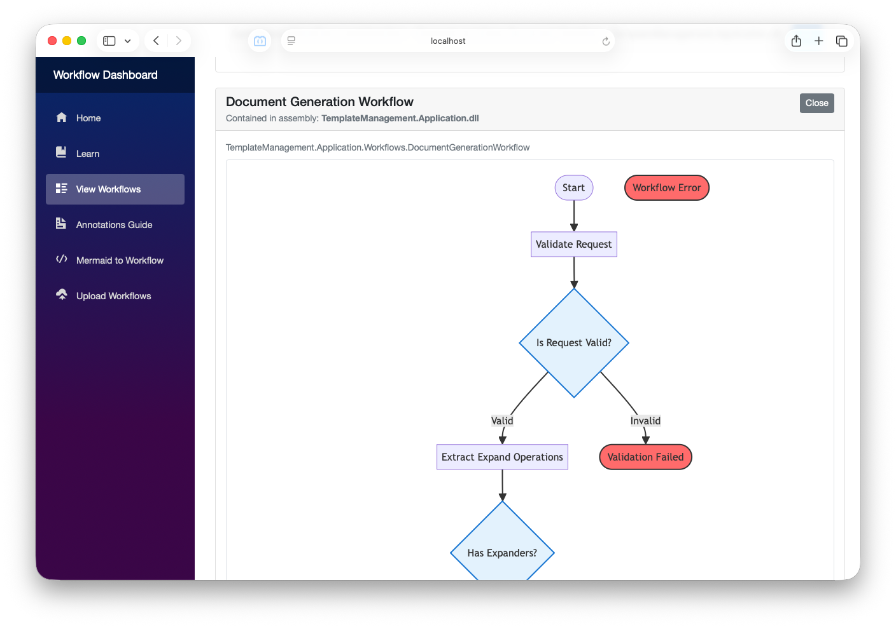
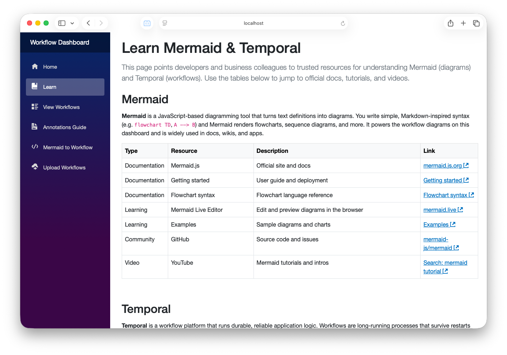
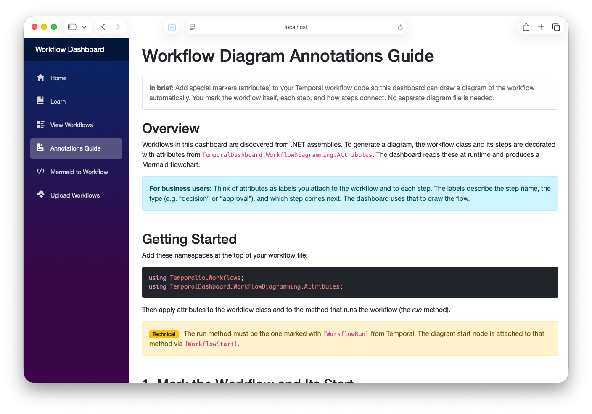
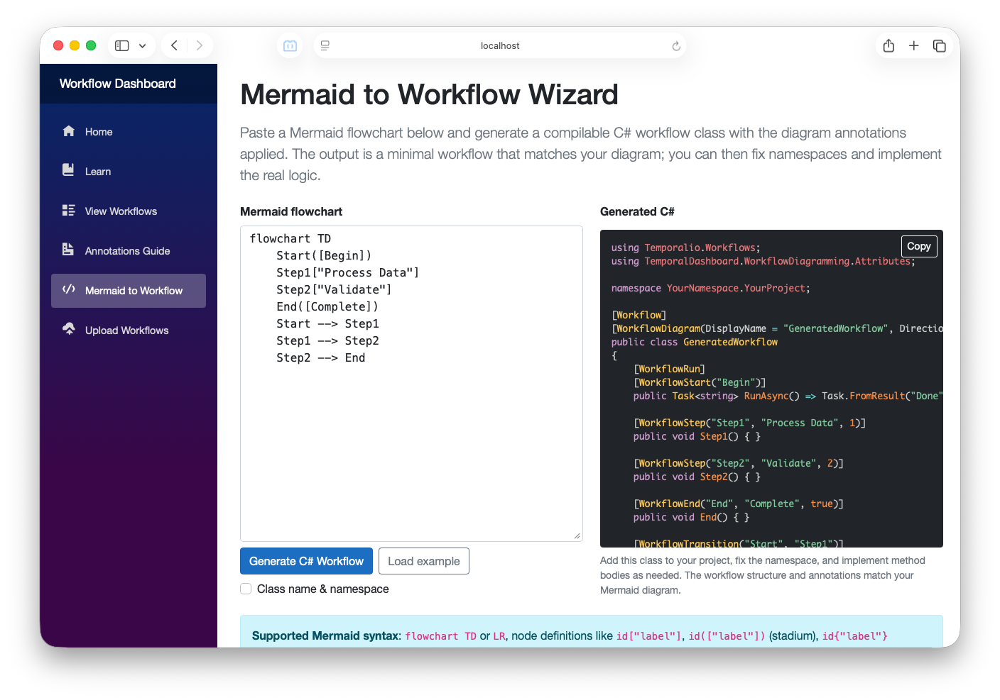

# Temporal Dashboard

A **multi-language** repository for discovering and visualizing [Temporal](https://temporal.io/) workflows. One Blazor dashboard and API sit on top of a shared Mermaid diagram package format; **per-language extractors** produce that package from Temporal SDKs so the UI stays the same whether workflows are written in .NET, TypeScript, Go, Java, Python, or Kotlin.

Upload a zip of .NET workflow DLLs **or** any extractor’s `workflow-diagrams.zip`, and the dashboard renders flowcharts without running the workflows.

---

## Multi-language repository

This is not a .NET-only codebase. Layout under `src/`:

| Area | Role |
|------|------|
| **`src/shared/`** | Language-agnostic contract: `packageName` metadata + Mermaid files ([schema](src/shared/workflow-diagrams-metadata.schema.json), [docs](src/shared/README.md)) |
| **`src/dotnet/`** | .NET attributes, Roslyn source analysis, MSBuild build tasks (NuGet packages) |
| **`src/typescript/`**, **`src/go/`**, **`src/java/`**, **`src/python/`**, **`src/kotlin/`** | Source extractors / CLIs for each Temporal SDK |
| **`src/TemporalDashboard.Api/`** + **`src/TemporalDashboard.Web/`** | Unified upload / discover / view UI (consumes the shared package) |

Every extractor emits the same zip shape (`workflow-diagrams-metadata.json` + `*.mermaid`). Product-level changes to that contract or extractor behavior should be applied across **all** languages (language-specific defect fixes may stay local) — see [AGENTS.md](AGENTS.md).

| Language | Extractor | Docs |
|----------|-----------|------|
| .NET / C# | `src/dotnet/` (attributes, Roslyn, MSBuild) | [Roslyn](src/dotnet/TemporalDashboard.WorkflowDiagramming.Roslyn/README.md), [Roslyn.Build](src/dotnet/TemporalDashboard.WorkflowDiagramming.Roslyn.Build/README.md) |
| TypeScript | `src/typescript/workflow-diagramming` | [README](src/typescript/workflow-diagramming/README.md) |
| Go | `src/go/workflowdiagramming` | [README](src/go/workflowdiagramming/README.md) |
| Java | `src/java/workflow-diagramming` | [README](src/java/workflow-diagramming/README.md) |
| Python | `src/python/workflow_diagramming` | [README](src/python/workflow_diagramming/README.md) |
| Kotlin | `src/kotlin/workflow-diagramming` | [README](src/kotlin/workflow-diagramming/README.md) |

---

## What is Temporal?

[Temporal](https://temporal.io/) is an open-source workflow engine that lets you write durable, long-running business logic as code. Instead of hand-rolling state machines, retries, and timers, you define **workflows** (the overall orchestration) and **activities** (the units of work). Temporal handles execution, retries, timeouts, and persistence so workflows survive process restarts and failures. Official SDKs span several languages; this repo mirrors that with extractors per SDK and one viewer for all of them.

---

## What This Project Does

- **Extract** workflow diagrams from Temporal source (or annotated .NET assemblies) using language-specific tools under `src/{dotnet,typescript,go,java,python,kotlin}`.
- **Upload** zip files containing .NET workflow DLLs and/or a shared `workflow-diagrams.zip` from any extractor.
- **Discover** workflows from uploaded DLLs (attributes) or diagram packages (`packageName` metadata).
- **Visualize** workflows as Mermaid flowcharts in one browser UI, regardless of implementation language.
- **Learn** .NET diagramming paths via the in-app **Diagramming Guide** and the **Mermaid to Workflow** wizard (C# attributes scaffold).

The dashboard does **not** run or execute workflows; it only inspects metadata and Mermaid artifacts.

**.NET:** attribute packages and attribute-free Roslyn build — [`TemporalDashboard.WorkflowDiagramming.Roslyn.Build`](src/dotnet/TemporalDashboard.WorkflowDiagramming.Roslyn.Build/README.md). **NuGet** publish on `main`: see [scripts/README.md](scripts/README.md).

**Other languages:** run that SDK’s extractor CLI, then upload the generated zip to the same Upload page.

---

## Architecture Overview

```
  Language extractors (any SDK)
  ┌──────────┐ ┌────┐ ┌──────┐ ┌────────┐ ┌────────┐ ┌────────┐
  │  .NET    │ │ TS │ │  Go  │ │  Java  │ │ Python │ │ Kotlin │
  └────┬─────┘ └──┬─┘ └──┬───┘ └───┬────┘ └───┬────┘ └───┬────┘
       │          │      │         │          │          │
       └──────────┴──────┴────┬────┴──────────┴──────────┘
                              │ same zip contract (src/shared)
                              ▼
┌─────────────────────────────────────────────────────────────────────────┐
│  TemporalDashboard.Web (Blazor Server)                                    │
│  • Upload UI, workflow list, diagram viewer                              │
└───────────────────────────────────┬─────────────────────────────────────┘
                                    │ HTTP
                                    ▼
┌─────────────────────────────────────────────────────────────────────────┐
│  TemporalDashboard.Api (ASP.NET Core)                                    │
│  • POST /api/upload/zip  → DLLs and/or diagram packages                 │
│  • GET /api/workflows    → discover uploads                             │
│  • GET /api/workflows/{name}/diagrams → Mermaid                         │
└─────────────────────────────────────────────────────────────────────────┘
```

- **Web** and **Api** are separate processes (different ports). In Docker, the web app talks to the API using the service name and internal port.
- Extractors never talk to the UI directly; they only need to emit the shared package format.

---

## UI Overview

The app is a Blazor Server UI with a top nav bar and several main pages. Below is how each screen looks and what it does. Screenshots use placeholders you can replace with real captures (see [docs/screenshots/README.md](docs/screenshots/README.md)).

### Navigation

The sidebar/top nav includes: **Home**, **Learn**, **View Workflows**, **Diagramming Guide**, **Mermaid to Workflow**, and **Upload Workflows**. Use **Upload Workflows** first to add a zip of workflow DLLs or a diagrams package, then **View Workflows** to see and diagram them.

### Home

Landing page with cards for **Upload**, **View Workflows**, **Diagramming Guide** (attributes vs Roslyn), and **Mermaid to Workflow**. A short bullet list explains what the dashboard does.



### Upload Workflows

Upload a zip file containing workflow DLLs and/or a `workflow-diagrams.zip` from either Build package (attributes or Roslyn). Choose a file with the file picker; the app uploads it to the API. Success and error messages appear below the picker. If an assembly folder already exists, you can choose to overwrite or cancel.



### View Workflows

Table of all discovered workflows: workflow name, diagram display name, and assembly (DLL). Each row has a **View** button that loads the Mermaid diagram for that workflow.



### Workflow Diagrams

When you click **View** on a workflow, a card opens showing the workflow’s Mermaid flowchart (steps, decisions, branches, etc.). You can close it to return to the table. Diagrams come from attributes on an uploaded DLL or from a pre-built diagrams package (attribute Build or Roslyn.Build).



### Learn

Intro/learning content about Mermaid, Temporal, and how this dashboard obtains diagrams (attributes vs Roslyn).



### Diagramming Guide

In-app guide covering **both** paths: Roslyn source analysis (no attributes) and the C# attribute set (`[WorkflowDiagram]`, `[WorkflowStep]`, `[WorkflowTransition]`, etc.). Formerly “Annotations Guide”.



### Mermaid to Workflow

Wizard that helps you go from a Mermaid flowchart to C# workflow code with **attributes** applied. For attribute-free Temporal code, use the Roslyn path in the Diagramming Guide instead.


---

## Repository Structure

```
temporal-workflow-viewer/
├── src/
│   ├── shared/                                   # Language-agnostic package schema + contract docs
│   ├── dotnet/                                   # .NET diagramming + extractors
│   │   ├── TemporalDashboard.WorkflowDiagramming/          # Attributes + Mermaid generator
│   │   ├── TemporalDashboard.WorkflowDiagramming.Build/    # MSBuild: attributes → .mermaid
│   │   ├── TemporalDashboard.WorkflowDiagramming.Roslyn/   # Roslyn source extractor
│   │   └── TemporalDashboard.WorkflowDiagramming.Roslyn.Build/
│   ├── typescript/workflow-diagramming/          # TypeScript extractor CLI
│   ├── go/workflowdiagramming/                   # Go extractor CLI
│   ├── java/workflow-diagramming/                # Java extractor CLI
│   ├── python/workflow_diagramming/              # Python extractor CLI
│   ├── kotlin/workflow-diagramming/              # Kotlin extractor CLI
│   ├── TemporalDashboard.Api/                    # REST API (upload + discovery)
│   └── TemporalDashboard.Web/                    # Blazor Server UI
├── tests/
│   └── dotnet/                                   # .NET unit tests for attributes + Roslyn
├── .github/workflows/ci.yml
├── TemporalDashboard.sln
└── README.md
```

---

## Projects at a Glance

| Project | Purpose |
|--------|---------|
| **src/shared** | Shared `workflow-diagrams-metadata.json` schema (`packageName`, …) consumed by every language extractor and the dashboard. |
| **src/dotnet/…WorkflowDiagramming** | C# attributes + Mermaid generator (`WorkflowDiagramModel`). |
| **src/dotnet/…Roslyn** | Roslyn extractor from Temporal C# source (no diagramming attributes). |
| **src/dotnet/…Roslyn.Build / …Build** | MSBuild tasks writing `.mermaid` + metadata zip at build time. |
| **src/typescript|go|java|python|kotlin** | Per-language source extractors → same diagram package format. |
| **TemporalDashboard.Api** | ASP.NET Core API: upload zip, list workflows, get Mermaid diagrams. |
| **TemporalDashboard.Web** | Blazor Server UI. |
| **tests/dotnet/…** | Unit tests for attributes and Roslyn extractors. |
| **TemporalDashboard.WorkflowDiagramming.Roslyn.Tests** | Unit tests for the Roslyn source extractor (attribute-free Temporal-style fixtures). |

---

## NuGet packages

### Published packages (this repo → NuGet.org)

These ship on push to `main` (see CI). Install scripts: [scripts/README.md](scripts/README.md).

| Package ID | When to use | Install |
|------------|-------------|---------|
| `TemporalDashboard.WorkflowDiagramming` | Annotate workflows with diagramming attributes; generate Mermaid from types | `dotnet add package TemporalDashboard.WorkflowDiagramming` |
| `TemporalDashboard.WorkflowDiagramming.Build` | Emit `.mermaid` / zip at build time from annotated DLLs | `dotnet add package TemporalDashboard.WorkflowDiagramming.Build` |
| `TemporalDashboard.WorkflowDiagramming.Roslyn` | Call the Roslyn extractor API from your own tools | `dotnet add package TemporalDashboard.WorkflowDiagramming.Roslyn` |
| `TemporalDashboard.WorkflowDiagramming.Roslyn.Build` | Emit `.mermaid` / zip at build time from normal Temporal C# (no attributes) | `dotnet add package TemporalDashboard.WorkflowDiagramming.Roslyn.Build` |

Typical consumer setups:

```bash
# Curated attribute diagrams + build-time output
dotnet add package TemporalDashboard.WorkflowDiagramming
dotnet add package TemporalDashboard.WorkflowDiagramming.Build
# or: ./scripts/install-workflow-diagramming-build.sh

# Attribute-free diagrams from source at build time
dotnet add package TemporalDashboard.WorkflowDiagramming.Roslyn.Build
# or: ./scripts/install-workflow-diagramming-roslyn-build.sh
```

`Roslyn` depends on `WorkflowDiagramming` (shared model + Mermaid renderer). The `.Build` packages are development dependencies (MSBuild tasks); they do not need to ship with your app.

---

## Prerequisites

- **.NET 10.0 SDK** (dashboard Web/API and `src/dotnet` packages).  
  Check: `dotnet --version`
- **Docker Desktop** (or Docker Engine + Docker Compose) if you want to run via Docker.
- **Per-language tooling** only if you develop or run that extractor (Node for TypeScript, Go toolchain, JDK/Maven or Gradle for Java/Kotlin, Python 3, etc.). See each extractor’s README.

---

## Getting Started

### Option 1: Docker (recommended for first run)

1. From the repo root:
   ```bash
   docker-compose up --build
   ```
2. Open **http://localhost:8000** in your browser.
3. Use **Upload Workflows** to upload a zip of workflow DLLs, then **View Workflows** and **View Diagrams**.

See **[DOCKER.md](DOCKER.md)** for ports, volumes, env vars, and troubleshooting.

### Option 2: Local development

1. **Start the API** (from repo root):
   ```bash
   cd src/TemporalDashboard.Api && dotnet run
   ```
   API: **https://localhost:7001** (or the port shown in the console.)

2. **Start the Web app** (second terminal):
   ```bash
   cd src/TemporalDashboard.Web && dotnet run
   ```
   Web: **https://localhost:7000** (or the port shown.)

3. Ensure the Web app’s `ApiBaseUrl` points to the API (see [Configuration](#configuration) below).

4. Open **https://localhost:7000** and use Upload Workflows → View Workflows → View Diagrams.

---

## Building and Testing

From the solution root:

```bash
# Build everything
dotnet build

# Run all tests
dotnet test
```

To run only the diagramming tests:

```bash
dotnet test tests/dotnet/TemporalDashboard.WorkflowDiagramming.Tests/TemporalDashboard.WorkflowDiagramming.Tests.csproj
dotnet test tests/dotnet/TemporalDashboard.WorkflowDiagramming.Roslyn.Tests/TemporalDashboard.WorkflowDiagramming.Roslyn.Tests.csproj
```

---

## CI/CD (GitHub Actions)

The [`.github/workflows/ci.yml`](.github/workflows/ci.yml) workflow runs on **push** and **pull_request** to `main`:

| Trigger        | Build & test | Package API+Web zip | Push to NuGet |
|----------------|--------------|----------------------|---------------|
| `pull_request` | ✅           | —                    | —             |
| `push` to main | ✅           | ✅                   | ✅            |

- **Build and test:** Restore, build in Release, run all tests.
- **Package app (push only):** Publishes the API and Web projects, zips them as `temporal-dashboard-api-and-web.zip`, and uploads it as a **GitHub Actions artifact**. Download it from the run’s **Summary** page (Artifacts).
- **NuGet (push only):** Packs `TemporalDashboard.WorkflowDiagramming`, `TemporalDashboard.WorkflowDiagramming.Build`, `TemporalDashboard.WorkflowDiagramming.Roslyn`, and `TemporalDashboard.WorkflowDiagramming.Roslyn.Build`, then pushes them to [NuGet.org](https://www.nuget.org/) (with `--skip-duplicate`).

**Required secret:** For NuGet push to succeed on the main repo, add a repository secret **`NUGET_API_KEY`** with your NuGet.org API key (from [NuGet.org → Account → API Keys](https://www.nuget.org/account/apikeys)).

---

## Configuration

### API (`src/TemporalDashboard.Api`)

- **UploadsPath** – Directory where uploaded zips are extracted (each DLL gets a folder named by assembly). Default: `uploads` under the API working directory.
- In Docker, this is typically something like `/app/uploads` and backed by a volume.

### Web (`src/TemporalDashboard.Web`)

- **ApiBaseUrl** – Base URL of the API (e.g. `https://localhost:7001` for local, or `http://api:8080` when the Web runs in Docker and calls the API service).

Edit `appsettings.json` or `appsettings.Development.json` as needed.

---

## API Endpoints

| Method | Path | Description |
|--------|------|-------------|
| POST | `/api/upload/zip` | Upload a zip file; optional query `overwrite=true` to replace existing assembly folders. |
| GET | `/api/workflows` | List all discovered workflows (from all uploaded DLLs). |
| GET | `/api/workflows/{dllName}/diagrams` | Get workflow types and Mermaid diagram text for the given DLL. |
| GET | `/api/upload/info` | Info about uploaded folders/files. |

---

## How Workflow Discovery Works

1. User uploads a **zip** via the Web UI → API receives it.
2. API extracts the zip to a temp folder and uses `WorkflowDiscoveryService` to find DLLs that contain at least one `[Workflow]` type (via a quick scan).
3. For each such DLL, the API copies it (and dependencies) into a dedicated folder under `UploadsPath`, named by the main assembly (file-name safe).
4. When listing workflows or diagrams, the API loads only the **main** DLL for each folder (e.g. `MyWorkflows/MyWorkflows.dll`) in a **collectible AssemblyLoadContext** so multiple versions of the same assembly name don’t collide. Diagramming and Temporal types are resolved from the default context so attribute reflection matches.
5. The service discovers types with `[Workflow]` and our diagramming attributes, then calls `WorkflowDiagramGenerator.GenerateMermaidDiagram(type)` to produce Mermaid text.
6. The Web app displays that text (e.g. via a Mermaid.js renderer) for each workflow.

Workflows must be annotated with the diagramming attributes to get meaningful diagrams in the dashboard today; see **[WORKFLOW_ATTRIBUTES_GUIDE.md](WORKFLOW_ATTRIBUTES_GUIDE.md)**. For attribute-free source extraction, use **TemporalDashboard.WorkflowDiagramming.Roslyn** (not yet wired into upload).

---

## Documentation for Developers

- **[WORKFLOW_ATTRIBUTES_GUIDE.md](WORKFLOW_ATTRIBUTES_GUIDE.md)** – Attribute path in detail (plus pointer to Roslyn). In-app: **/guide** Diagramming Guide.
- **[DOCKER.md](DOCKER.md)** – Docker Compose services, ports, environment variables, and common commands.
- **src/shared/README.md** – Multi-language diagram package contract (`packageName`).
- **src/dotnet/TemporalDashboard.WorkflowDiagramming/README.md** – .NET diagramming library and attributes.
- **src/dotnet/TemporalDashboard.WorkflowDiagramming.Roslyn/README.md** – Roslyn source extractor.
- **src/dotnet/TemporalDashboard.WorkflowDiagramming.Roslyn.Build/README.md** – Build-time Roslyn generation.
- **src/dotnet/TemporalDashboard.WorkflowDiagramming.Build/README.md** – Build-time attribute generation.
- **src/{typescript,go,java,python,kotlin}/** – Per-language extractor READMEs.

---

## For New Developers: Working With and Extending the Codebase

### Making changes

- **Diagramming logic** – Edit `WorkflowDiagramGenerator.cs`, `MermaidDiagramRenderer.cs`, and the types in `Attributes/` / `Models/`. Add or adjust attributes in `Attributes/` and update the generator to read them. Add tests in `TemporalDashboard.WorkflowDiagramming.Tests` (see existing `Workflows/` samples and test files). For source-based extraction, edit `TemporalDashboard.WorkflowDiagramming.Roslyn` and its tests.
- **Roslyn extractor** – Pattern matching lives in `RoslynWorkflowDiagramExtractor.cs`; keep Mermaid styling in the shared renderer so both paths stay consistent.
- **API behavior** – Controllers in `TemporalDashboard.Api/Controllers`, discovery and upload logic in `Services/WorkflowDiscoveryService.cs`. Config in `appsettings.json`.
- **UI** – Blazor pages in `TemporalDashboard.Web/Pages`, layout and nav in `Shared/`, API calls in `Services/ApiClient.cs`.

### Adding a new API endpoint

1. Add the action on the appropriate controller (or create a new controller and register it).
2. If it returns new DTOs, add or reuse models under `Api/Models`.
3. Call the new endpoint from the Web app’s `ApiClient` and add or update a page to use it.

### Adding a new diagramming attribute

1. Add the attribute class under `TemporalDashboard.WorkflowDiagramming/Attributes`.
2. In `WorkflowDiagramGenerator`, read the attribute via reflection and extend the Mermaid generation (nodes/edges) accordingly.
3. Add unit tests and, if useful, a sample workflow in `tests/.../Workflows/`.
4. Update **WORKFLOW_ATTRIBUTES_GUIDE.md** and the in-app Diagramming Guide (`/guide`) so users know how to use it (and how it relates to the Roslyn path).

### Testing

- Run `dotnet test` before submitting changes. The diagramming tests use in-memory workflow types and do not require the API or Web to be running.
- For manual testing, use Docker or run Api + Web locally and upload a zip that contains workflow DLLs annotated with the diagramming attributes.

### Tech stack summary

- **.NET 10**, C# with nullable reference types.
- **TemporalDashboard.Api**: ASP.NET Core, minimal hosting, OpenAPI in Development.
- **TemporalDashboard.Web**: Blazor Server, Bootstrap, Open Iconic.
- **Diagram output**: Mermaid flowchart syntax, rendered in the browser (e.g. Mermaid.js).
- **Packages / dependencies**: see [NuGet packages](#nuget-packages) above.
---

## License and Contributing

- **License**: [LICENSE](LICENSE) (MIT).
- **Contributing**: See [CONTRIBUTING.md](CONTRIBUTING.md) for how to contribute (setup, PRs, tests).
- **Code of conduct**: [CODE_OF_CONDUCT.md](CODE_OF_CONDUCT.md) (Contributor Covenant).
- **Security**: See [SECURITY.md](SECURITY.md) for how to report vulnerabilities.
