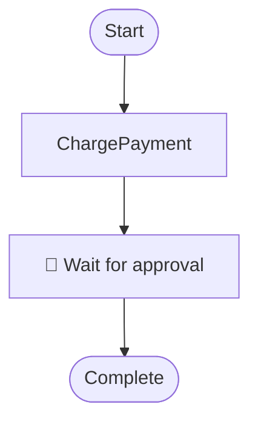

# Shared workflow diagram package format

Language extractors under `src/typescript`, `src/go`, `src/java`, `src/python`, `src/kotlin`, and `src/dotnet` all emit the **same** zip (or output directory) contract. The Temporal Dashboard UI and API consume this package **regardless of language** — upload a zip produced by any extractor and the viewer treats it the same way.

## Package contents

| Path | Required | Description |
|------|----------|-------------|
| `workflow-diagrams-metadata.json` | yes | Package identity + workflow index (see schema) |
| `*.mermaid` | yes (one per workflow) | Mermaid flowchart for each discovered workflow |
| `workflow-diagrams.zip` | optional | Archive of the metadata + mermaid files for sharing |

## Metadata

See [`workflow-diagrams-metadata.schema.json`](./workflow-diagrams-metadata.schema.json).

Primary identity field is **`packageName`** (not `assemblyName`). When writing new packages, emit only `packageName` / `packageVersion` / `packagePath`. Older .NET packages may still include legacy `assemblyName` aliases; readers should prefer `packageName` and fall back if needed.

```json
{
  "packageName": "my-workflows",
  "packageVersion": "1.0.0",
  "packagePath": "/path/to/source",
  "language": "TypeScript",
  "targetFramework": "node20",
  "buildDateUtc": "2026-10-14T12:00:00.000Z",
  "generator": "@temporal-dashboard/workflow-diagramming-typescript/0.1.0",
  "workflows": [
    {
      "name": "orderWorkflow",
      "displayName": "orderWorkflow",
      "diagramFile": "orderWorkflow.mermaid"
    }
  ]
}
```

`language` values used by extractors: `TypeScript`, `Go`, `Java`, `Python`, `Kotlin`, `C#`.

## Mermaid diagrams (v1)

Each `.mermaid` file is a `flowchart TD` with:

- `Start([...])` stadium node
- Activity / child-workflow steps as rectangle nodes
- Wait / human / condition steps as `["👤 label"]`
- `End(["Complete"])` stadium node
- Linear edges `A --> B` for v1 (branching/parallel can be added later)

Example:



## Extractors

| Language | Path | CLI sketch |
|----------|------|------------|
| TypeScript | [`../typescript/workflow-diagramming`](../typescript/workflow-diagramming) | `npx tsx src/cli.ts <dir>` |
| Go | [`../go/workflowdiagramming`](../go/workflowdiagramming) | `go run ./cmd/extract --dir ...` |
| Java | [`../java/workflow-diagramming`](../java/workflow-diagramming) | `mvn -q exec:java -Dexec.args="..."` |
| Python | [`../python/workflow_diagramming`](../python/workflow_diagramming) | `python -m workflow_diagramming extract <dir>` |
| Kotlin | [`../kotlin/workflow-diagramming`](../kotlin/workflow-diagramming) | `./gradlew run --args="..."` |
| C# (.NET) | [`../dotnet`](../dotnet) | MSBuild / NuGet build tasks |

## Upload to the dashboard

1. Run an extractor against your workflow source tree (or build with a .NET diagramming package).
2. Take `workflow-diagrams.zip` (or zip the diagrams folder yourself).
3. Upload via the Temporal Dashboard Web UI or API — the server reads `workflow-diagrams-metadata.json` and associates each `diagramFile` with its workflow entry.
